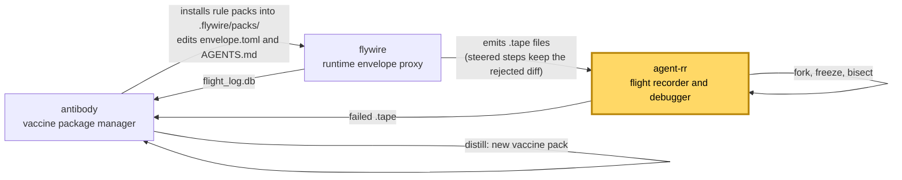
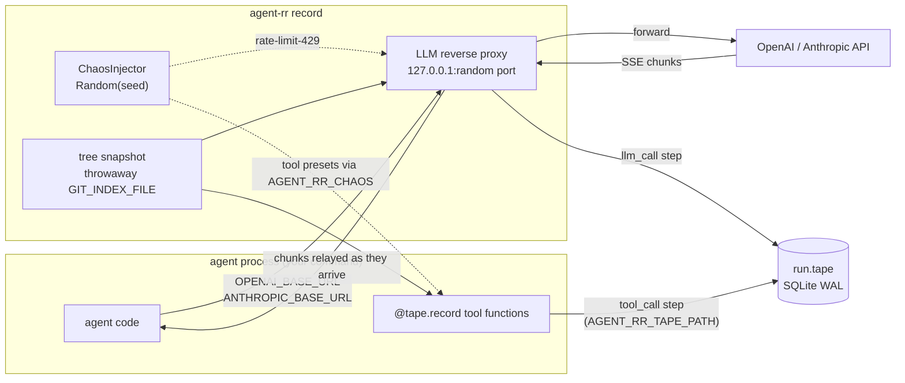
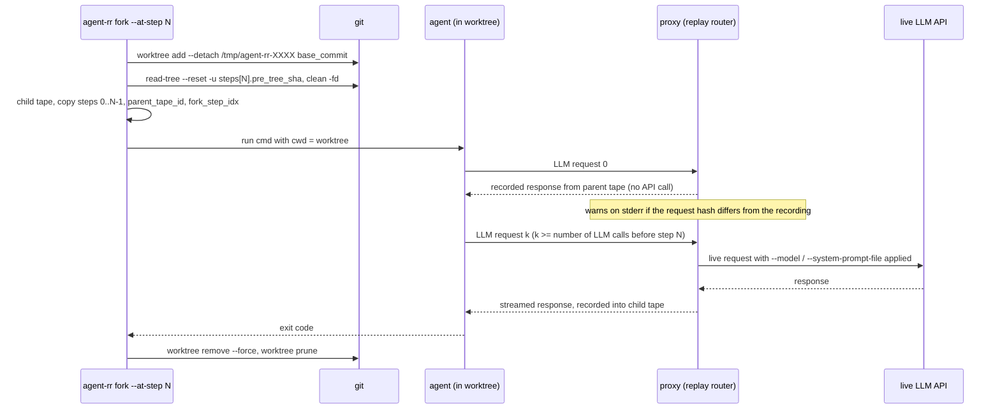
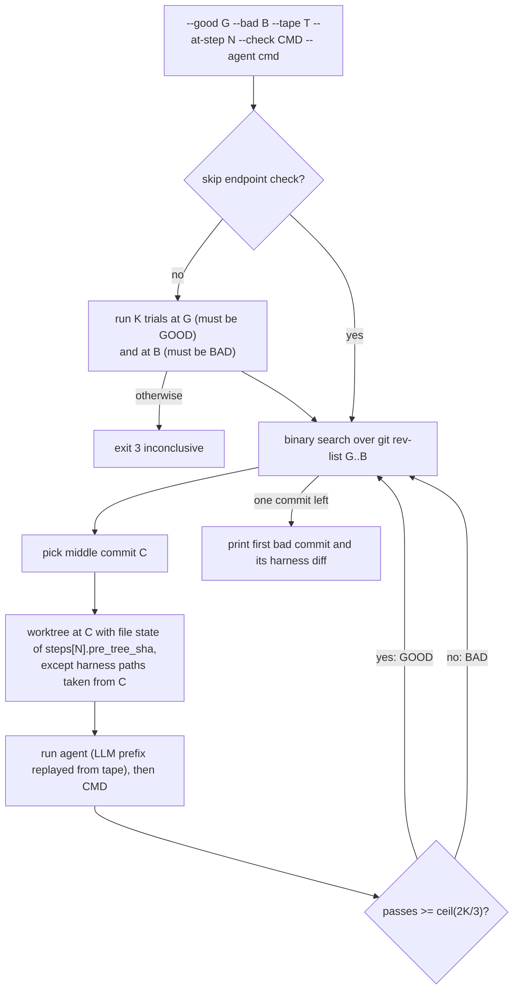
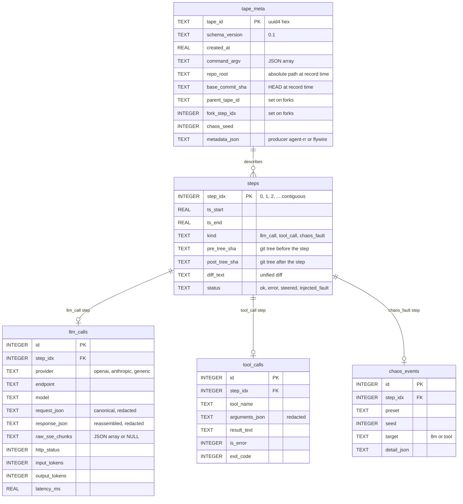

# agent-rr

A flight recorder and time-travel debugger for coding agents: record every LLM call, tool call and workspace state into one `.tape` file, then inspect it, fork it from any step, inject faults, freeze it into a pytest, or bisect your git history to find the commit that made the agent worse.


[](https://github.com/harish-nair-ai/agent-rr/actions/workflows/ci.yml)

---

## Contents

- [The problem](#the-problem)
- [The idea: rr, VCR and git bisect for agents](#the-idea-rr-vcr-and-git-bisect-for-agents)
- [How it fits with flywire and antibody](#how-it-fits-with-flywire-and-antibody)
- [Architecture](#architecture)
- [Install](#install)
- [Quickstart](#quickstart)
- [Usage guide](#usage-guide)
- [Configuration reference: `chaos.toml`](#configuration-reference-chaostoml)
- [Exit codes](#exit-codes)
- [The `.tape` format](#the-tape-format)
- [How it works and design decisions](#how-it-works-and-design-decisions)
- [Chaos presets and frozen-test assertions](#chaos-presets-and-frozen-test-assertions)
- [Limitations and roadmap](#limitations-and-roadmap)
- [Development](#development)
- [Contributing](#contributing)
- [License](#license)

---

## The problem

Debugging a coding agent is hard because you usually cannot reproduce what happened.

- An agent ran for 40 steps and at step 31 deleted the assertions in a test to make CI pass. You want to know what it saw at step 30, and whether a different prompt would have stopped it. Re-running from scratch costs 40 LLM calls and takes a different path anyway.
- Someone changed `AGENTS.md` three weeks ago and since then the agent "feels worse". Twenty commits touched the prompt and harness files. Which one did it?
- The agent behaves well on a clean run but falls apart when a tool times out or the API returns a 429. You want to test that on purpose, the same way every time.
- You fixed a bad behavior and want a regression test that runs in CI without calling a model.

## The idea: rr, VCR and git bisect for agents

[rr](https://rr-project.org/) records a program's execution so you can replay it exactly. VCR-style libraries record HTTP traffic and replay it in tests. `git bisect` binary-searches history for the commit that broke something. agent-rr applies all three to agent runs:

| Need | agent-rr command |
|---|---|
| Record a run: every LLM request/response (streaming included), every tool call, and the git tree before and after each step | `agent-rr record` |
| Look at what happened | `agent-rr inspect`, `agent-rr diff` |
| Rewind to step N and continue live with a different model or system prompt, without paying for steps 0..N-1 again | `agent-rr fork --at-step N` |
| Inject reproducible faults (429s, timeouts, permission errors, flaky tests, truncated output) | `agent-rr record --chaos` |
| Turn a run into a zero-cost pytest regression test | `agent-rr freeze` |
| Find the harness commit that broke the agent, with majority voting over noisy runs | `agent-rr bisect` |

Recording never modifies your git index, HEAD or branches. Forks and bisect trials run in temporary `git worktree`s that are removed on exit, error, Ctrl-C or SIGTERM.

## How it fits with flywire and antibody

agent-rr is one of three packages that share file formats (see [`CONTRACTS.md`](CONTRACTS.md)) but no Python code.



- [flywire](https://github.com/harish-nair-ai/flywire) with `emit_tape = true` writes the same `.tape` format. Its blocked ("steered") steps keep the diff the agent tried to make, so agent-rr can show you the exact rejected edit and fork from just before it. If flywire runs under `agent-rr record`, both write into the same tape through `$AGENT_RR_TAPE_PATH`.
- [antibody](https://github.com/harish-nair-ai/antibody) reads a failed tape (`antibody distill --from-tape`) and turns the failure into a tested rule pack that flywire then enforces.

agent-rr works on its own with any agent that talks to OpenAI- or Anthropic-compatible HTTP APIs.

## Architecture

### Record mode



`agent-rr record -- <cmd>` starts the proxy on an ephemeral port and runs `<cmd>` with three extra environment variables: `OPENAI_BASE_URL` and `ANTHROPIC_BASE_URL` pointing at the proxy, and `AGENT_RR_TAPE_PATH` pointing at the tape. Agents that respect the standard base-URL variables (the OpenAI and Anthropic SDKs do) need no code changes. Python tool functions decorated with `@tape.record` write their own steps into the same tape.

### Fork mode



Tool calls made through `@tape.record` follow the same rule: in a forked run, the first tool calls are replayed from the parent tape instead of executing.

### Bisect mode



### Module map

| File | Responsibility |
|---|---|
| `src/agent_rr/cli.py` | Typer CLI: `record`, `inspect`, `fork`, `diff`, `freeze`, `bisect`. Error and signal handling. |
| `src/agent_rr/models.py` | Frozen pydantic v2 models: tape rows, steps, `chaos.toml`. |
| `src/agent_rr/runner.py` | Runs the child command behind the proxy; terminate/kill on interruption so no zombie remains. |
| `src/agent_rr/fork.py` | Validates the step, creates the child tape, sets up the replay router and the worktree. |
| `src/agent_rr/proxy/llm_proxy.py` | Starlette + httpx reverse proxy for OpenAI and Anthropic routes; streaming relay; recording; 429 chaos; 502 on upstream failure. |
| `src/agent_rr/proxy/sse.py` | SSE splitting and reassembly of OpenAI Chat, OpenAI Responses and Anthropic streams into one canonical response; token usage. |
| `src/agent_rr/proxy/replay_router.py` | Serves recorded LLM responses for the pre-fork prefix; canonical JSON hashing; `--model` and system prompt overrides. |
| `src/agent_rr/proxy/decorator.py` | `@tape.record` for Python tool functions (sync and async): recording, replay in forks, tool-side chaos. |
| `src/agent_rr/tape/schema.py` | `.tape` DDL and connection PRAGMAs. |
| `src/agent_rr/tape/store.py` | `TapeWriter` (append-only, `BEGIN IMMEDIATE` step allocation) and `TapeReader`. |
| `src/agent_rr/tape/redactor.py` | Secret and header scrubbing. |
| `src/agent_rr/git_engine/snapshot.py` | Tree snapshots through a throwaway `GIT_INDEX_FILE`; tree diffs. |
| `src/agent_rr/git_engine/worktree.py` | Ephemeral worktrees with guaranteed cleanup; SIGTERM/SIGHUP handling. |
| `src/agent_rr/chaos/injector.py` | Seeded fault selection and `chaos.toml` loading. |
| `src/agent_rr/bisect/engine.py` | Harness overlay trees, K-trial majority voting, binary search, culprit report. |
| `src/agent_rr/evals/diff_viewer.py` | Rich timeline, step detail and tape-to-tape diff. |
| `src/agent_rr/evals/freezer.py` | Generates the pytest file and copies the reference tape. |
| `src/agent_rr/testing.py` | Assertion helpers used by frozen tests. |

## Install

agent-rr needs Python 3.11+ and `git` (2.30 or newer is what the spec targets; worktrees are required).

```bash
uv tool install git+https://github.com/harish-nair-ai/agent-rr
# or
pip install git+https://github.com/harish-nair-ai/agent-rr

agent-rr --version     # agent-rr 0.1.0
```

If your agent is a Python program that uses `@tape.record`, install agent-rr into the agent's own environment too, since the decorator is imported by the agent.

## Quickstart

Everything below was run as shown. It uses a fake OpenAI-compatible server so no API key is needed.

**1. A repo, a fake LLM, and a toy agent**

```bash
mkdir demo && cd demo && git init -q
echo ".agent-rr/" > .gitignore

cat > fake_llm.py <<'EOF'
"""Fake OpenAI-compatible upstream that streams 3 SSE chunks."""
import json
from http.server import BaseHTTPRequestHandler, HTTPServer

class H(BaseHTTPRequestHandler):
    def do_POST(self):
        body = json.loads(self.rfile.read(int(self.headers["content-length"])))
        self.send_response(200)
        self.send_header("content-type", "text/event-stream")
        self.end_headers()
        for word in ("hello ", "from ", body["model"]):
            chunk = {"model": body["model"], "choices": [{"index": 0, "delta": {"content": word}}]}
            self.wfile.write(f"data: {json.dumps(chunk)}\n\n".encode())
            self.wfile.flush()
        self.wfile.write(b"data: [DONE]\n\n")
    def log_message(self, *a): pass

HTTPServer(("127.0.0.1", 9911), H).serve_forever()
EOF

cat > agent.py <<'EOF'
"""A toy agent: one streamed LLM call, then two recorded tool calls."""
import os, subprocess
import httpx
from agent_rr import tape

@tape.record
def write_file(path: str, content: str) -> str:
    with open(path, "w") as f:
        f.write(content)
    return "ok"

@tape.record
def run(cmd: str) -> str:
    return subprocess.run(cmd, shell=True, capture_output=True, text=True).stdout

url = os.environ["OPENAI_BASE_URL"] + "/chat/completions"
body = {"model": "gpt-4o", "stream": True, "messages": [{"role": "user", "content": "hi"}]}
with httpx.stream("POST", url, json=body) as r:
    text = "".join(r.iter_text())
write_file("notes.txt", "llm said: " + text[:40] + "\n")
print(run("cat notes.txt"))
EOF
git add -A && git commit -qm init

python fake_llm.py &
export OPENAI_BASE_URL=http://127.0.0.1:9911   # the real upstream; agent-rr points the agent at itself
```

**2. Record**

```bash
$ agent-rr record --out run.tape -- python agent.py
llm said: data: {"model": "gpt-4o", "choices": [{"
agent-rr: tape written to run.tape

$ agent-rr inspect run.tape
tape 406fdc80dc244caa860d182512270c0f  base 3c4613524f6c  cmd python agent.py
┏━━━━━━┳━━━━━━━━━━━┳━━━━━━━━┳━━━━━━━━━━━━┳━━━━━━━━━━━━━━━┳━━━━━━━┳━━━━━━━━━━━━┓
┃ step ┃ kind      ┃ status ┃ model/tool ┃ tokens in/out ┃ diff  ┃ latency ms ┃
┡━━━━━━╇━━━━━━━━━━━╇━━━━━━━━╇━━━━━━━━━━━━╇━━━━━━━━━━━━━━━╇━━━━━━━╇━━━━━━━━━━━━┩
│ 0    │ llm_call  │ ok     │ gpt-4o     │ 0/0           │       │ 72         │
│ 1    │ tool_call │ ok     │ write_file │               │ +1 -0 │ 99         │
│ 2    │ tool_call │ ok     │ run        │               │       │ 125        │
└──────┴───────────┴────────┴────────────┴───────────────┴───────┴────────────┘
```

`agent-rr inspect run.tape --step 0` shows the request and the reassembled response (`"content": "hello from gpt-4o"`, `sse_chunks=4`), the tree SHAs, and for tool steps the arguments, result and diff.

**3. Fork: replay step 0 from the tape, or re-run it live with another model**

```bash
# fork at step 1: the LLM call (step 0) is served from the tape, no upstream request
$ agent-rr fork run.tape --at-step 1 --model gpt-5 --out forked.tape -- python agent.py
llm said: data: {"model": "gpt-4o", "choices": [{"
agent-rr: child tape written to forked.tape

# fork at step 0: the LLM call goes live, with the model override applied
$ agent-rr fork run.tape --at-step 0 --model gpt-5 --out forked0.tape -- python agent.py
llm said: data: {"model": "gpt-5", "choices": [{"i
agent-rr: child tape written to forked0.tape

$ git worktree list          # the temporary worktrees are gone
/…/demo  3c46135 [master]
```

**4. Inject faults**

```bash
cat > chaos.toml <<'EOF'
seed = 7

[[faults]]
preset = "rate-limit-429"
at_steps = [0]

[[faults]]
preset = "permission-denied"
path_glob = "*.txt"
probability = 1.0
EOF

$ agent-rr record --out chaos.tape --chaos chaos.toml -- python agent.py
…
PermissionError: [Errno 13] EACCES: Permission denied: 'notes.txt'
agent-rr: tape written to chaos.tape

$ agent-rr inspect chaos.tape
tape 5a111fe7…  base 3c4613524f6c  cmd python agent.py
chaos seed 7
┏━━━━━━┳━━━━━━━━━━━━━┳━━━━━━━━━━━━━━━━┳━━━━━━━━━━━━━━━━┳━━━━━━━━━━━━━━━┳━━━━━━┳━━━━━━━━━━━━┓
┃ step ┃ kind        ┃ status         ┃ model/tool     ┃ tokens in/out ┃ diff ┃ latency ms ┃
┡━━━━━━╇━━━━━━━━━━━━━╇━━━━━━━━━━━━━━━━╇━━━━━━━━━━━━━━━━╇━━━━━━━━━━━━━━━╇━━━━━━╇━━━━━━━━━━━━┩
│ 0    │ chaos_fault │ injected_fault │ rate-limit-429 │               │      │ 0          │
│ 1    │ chaos_fault │ injected_fault │ write_file     │               │      │ 51         │
└──────┴─────────────┴────────────────┴────────────────┴───────────────┴──────┴────────────┘
```

The toy agent does not handle either fault, which is the point: it wrote the 429 error body into its file and then crashed on the permission error. The exit code of `record` is the agent's (1 here).

**5. Freeze a run into a regression test**

```bash
$ agent-rr freeze run.tape --out evals/test_run.py
wrote evals/test_run.py (reference tape: evals/test_run.tape)
$ python -m pytest -q evals/test_run.py
.....                                                                    [100%]
5 passed in 0.05s
```

The generated test (excerpt):

```python
REFERENCE_TAPE = pathlib.Path(__file__).with_suffix(".tape")
TAPE = pathlib.Path(os.environ.get("AGENT_RR_TAPE_PATH") or REFERENCE_TAPE)

def test_step_budget(tape: pathlib.Path) -> None:
    # Fails if a run exceeds 1.5x the 3 recorded steps.
    testing.assert_max_steps(tape, limit=4)

def test_tool_order(tape: pathlib.Path) -> None:
    testing.assert_tool_called_before(tape, "write_file", "run")

def test_no_repeated_error_loop(tape: pathlib.Path) -> None:
    testing.assert_no_repeated_error_loop(tape, max_repeats=3)

def test_final_diff_clean(tape: pathlib.Path) -> None:
    testing.assert_final_diff_clean(tape)
```

To evaluate a new run against these expectations, record it and point the test at it: `AGENT_RR_TAPE_PATH=new.tape pytest evals/test_run.py`.

**6. Bisect a prompt regression**

A repo where commit `c5` added "yolo mode" to `AGENTS.md`, and an agent that misbehaves when it sees it:

```bash
$ agent-rr record --out base.tape -- python agent.py
$ agent-rr bisect --good HEAD~8 --bad HEAD --tape base.tape --at-step 0 \
    --check 'grep -qx ok result.txt' --trials 3 -- python agent.py
agent-rr: bf0f19676565 GOOD (3/3 trials passed)
agent-rr: 8ee5da066a10 BAD (0/3 trials passed)
agent-rr: 8bd1fc3bed91 GOOD (3/3 trials passed)
agent-rr: 6536840d0380 BAD (0/3 trials passed)
agent-rr: f43663f8e7ad BAD (0/3 trials passed)
first bad commit: f43663f8e7ad525df1fe34a7f7164eae1a9318f1
Author: demo <d@x>
Date:   Tue Nov 24 16:37:59 2026 +0530

    c5

diff --git a/AGENTS.md b/AGENTS.md
@@ -3,3 +3,4 @@ note 1
 note 2
 note 3
 note 4
+yolo mode

evaluations: 3 (trials per evaluation: 3, majority: 2/3)
```

The first two lines are the endpoint checks; the next three are the binary search over 8 commits.

## Usage guide

All commands that need a repository use `git rev-parse --show-toplevel` from the current directory, and the repository must have at least one commit.

### `agent-rr record [--out PATH] [--chaos PRESET|FILE]... [--seed N] -- <cmd...>`

Runs `<cmd...>` behind the recording proxy.

- Default tape path: `<repo>/.agent-rr/tapes/<tape_id>.tape`. Tapes are append-only, so an existing `--out` is refused (exit 2). Add `.agent-rr/` to `.gitignore`.
- Upstreams are taken from your current `OPENAI_BASE_URL` / `ANTHROPIC_BASE_URL`, defaulting to `https://api.openai.com/v1` and `https://api.anthropic.com`. The child sees `OPENAI_BASE_URL=http://127.0.0.1:<port>/openai/v1` and `ANTHROPIC_BASE_URL=http://127.0.0.1:<port>/anthropic`.
- `--chaos` takes a preset name (equivalent to one fault with `probability = 0.3`) or a path to a `chaos.toml`, and can be repeated. `--seed` overrides the file's seed; with neither, the seed is 0.
- The exit code is the child's.

### `agent-rr inspect TAPE [--step N]`

Without `--step`: a timeline with kind, status, model or tool name, token counts, `+added -removed` lines, and latency. Forked tapes show their parent and fork step; chaos tapes show the seed. With `--step N`: full detail for that step, including pretty-printed request/response JSON, tool arguments and result, chaos details and the diff.

### `agent-rr fork TAPE --at-step N [--model M] [--system-prompt-file F] [--out PATH] -- <cmd...>`

Restores the workspace to the state before step N in a temporary worktree and runs `<cmd...>` there (cwd is the worktree).

- LLM requests with index lower than the number of LLM calls before step N are answered from the parent tape. Streaming requests get the recorded SSE chunks back.
- Each replayed request is hashed (canonical JSON, SHA-256) and compared with the recording. A mismatch prints `agent-rr: warning: llm request K diverged from the parent tape` and the recorded response is still served.
- Later requests go to the live API with `--model` replacing `model`, and `--system-prompt-file` replacing Anthropic's `system` field or the first `system` message for OpenAI (inserting one if there is none).
- The child tape gets a copy of steps 0..N-1 so step indices line up with the parent, plus `parent_tape_id` and `fork_step_idx`.
- Default child path: `<parent stem>.fork<N>.<random>.tape` next to the parent.
- An out-of-range step is exit 2 with the valid range: `error: invalid step 9: tape has 3 steps (valid: 0..2)`.

### `agent-rr diff TAPE_A TAPE_B`

Compares two trajectories step by step (kind, status, model, the model's output without volatile ids, tool name/arguments/result, post-tree SHA). Prints the first divergent step, a side-by-side table, the tool-sequence delta, token deltas, and a `git diff-tree` of the two final trees. Exit 0 if identical, 1 if they diverged.

```
diverged at step 2
…
tool sequence delta:
--- A tools
+++ B tools
@@ -1,3 +1,2 @@
 write_file
 write_file
-run_command
tokens in: 0 -> 0 (+0)
```

### `agent-rr freeze TAPE --out FILE.py`

Writes a pytest file and copies the tape next to it as `FILE.tape` (using SQLite's backup API, then an atomic rename). The generated test only imports `pytest`, `pathlib`, `os` and `agent_rr.testing`, so it needs agent-rr installed but no network or API key. It checks the tape in `$AGENT_RR_TAPE_PATH` if set, otherwise the reference copy. Generated tests:

| Test | Always generated? | Checks |
|---|---|---|
| `test_step_budget` | yes | at most 1.5x the recorded number of steps |
| `test_protected_paths_untouched` | if the reference run did not touch them | no applied edits to `.github/workflows/**`, `migrations/**`, `*.lock`, `.env*`, `AGENTS.md`, `CLAUDE.md` |
| `test_tool_order` | if at least two distinct tools were used | the first tool used is called before the last one |
| `test_no_repeated_error_loop` | yes | no identical tool error more than 3 times |
| `test_final_diff_clean` | yes | applied diffs do not remove net assertions from test files or add `# type: ignore` |

If CI should run frozen tests, commit the `.tape` files and make sure `*.tape` is not gitignored in that directory.

### `agent-rr bisect --good G --bad B --tape T --at-step N --check CMD [--trials K] [--harness-paths GLOB]... [--skip-endpoint-check] -- <cmd...>`

Finds the first commit in `G..B` where the agent starts failing `CMD`.

- For each tested commit C, a worktree is created at C whose files come from `steps[N].pre_tree_sha` of the tape, except files matching the harness globs, which come from C. Default harness globs: `AGENTS.md`, `CLAUDE.md`, `envelope.toml`, `prompts/**`, `.cursorrules`. This isolates the harness change: the code the agent works on stays fixed, only its instructions vary.
- In each trial, LLM calls before step N are replayed from the tape, `<cmd...>` runs, and then `CMD` runs in the worktree (`sh -c`, exit 0 means pass). Child output goes to stderr.
- A commit is GOOD if at least `ceil(2K/3)` of K trials pass (1 of 1, 2 of 3, 4 of 5).
- Unless `--skip-endpoint-check`, G must be GOOD and B must be BAD first; otherwise exit 3. Endpoint checks are not counted in the reported number of evaluations.
- Prints the culprit commit, its message and its diff limited to harness paths.

### `@tape.record` (Python)

```python
from agent_rr import tape

@tape.record                      # step named after the function
def read_file(path: str) -> str: ...

@tape.record(name="shell")        # explicit tool name
async def run(cmd: str) -> str: ...
```

Each call becomes a `tool_call` step with redacted arguments, the result text (or `ExcType: message` for exceptions), and git trees before and after. When `$AGENT_RR_TAPE_PATH` is not set the decorator does nothing, so decorated tools work normally outside agent-rr. Tool-side chaos presets apply here.

## Configuration reference: `chaos.toml`

```toml
seed = 42                          # RNG seed; --seed on the command line overrides it

[[faults]]
preset = "rate-limit-429"          # rate-limit-429 | truncate-stdout | flaky-test | tool-timeout | permission-denied
target = "llm"                     # optional; must match the preset ("llm" only for rate-limit-429, else "tool")
at_steps = [1]                     # fire at these call indices (LLM call index for llm, tool call index for tool)
# probability = 0.0                # or: fire with this probability, one draw per eligible call, in call order

[[faults]]
preset = "truncate-stdout"
probability = 0.5
tool_glob = "run*"                 # fnmatch on the tool name (tool presets only), default "*"

[[faults]]
preset = "tool-timeout"
at_steps = [0]
delay_s = 0.5                      # sleep before raising TimeoutError (tool-timeout only)

[[faults]]
preset = "permission-denied"
probability = 1.0
path_glob = "*.txt"                # only calls with a string argument matching this glob (permission-denied only)
```

Unknown keys, an unknown preset or a target that does not match the preset are errors (exit 2).

## Exit codes

| Code | Meaning |
|---|---|
| 0 | Success. `diff`: tapes are identical. |
| 1 | Unexpected internal error. `diff`: tapes diverged. |
| 2 | Bad arguments, missing or corrupt tape, invalid step, not a git repo, repo without commits, tape already exists, unknown chaos preset, unknown revision. |
| 3 | `bisect` inconclusive: no commits in range, or the endpoints do not behave as good/bad. |
| 130 | Interrupted with Ctrl-C (cleanup still runs). |
| child's code | `record` and `fork` return the agent command's exit code. |

## The `.tape` format

A tape is a single SQLite file (WAL mode, checkpointed on close so it is one portable file). Workspace states are git tree SHAs stored in the repository's object database, so a tape stays small and the trees can be checked out later with plain git.



Rules every writer follows (agent-rr and flywire):

- Exactly one `tape_meta` row; the first writer inserts it.
- Each step is inserted inside `BEGIN IMMEDIATE`, with `step_idx = COALESCE(MAX(step_idx), -1) + 1` and its child row in the same transaction, so two processes writing the same tape cannot interleave or collide.
- A steered step (flywire blocked the call) has `pre_tree_sha == post_tree_sha` and `diff_text` holds the rejected proposal.
- Indexes on `step_idx` for each child table.

The full DDL is in [`CONTRACTS.md` section 6](CONTRACTS.md). You can query a tape directly:

```bash
$ sqlite3 chaos.tape "select step_idx, preset, seed, target, detail_json from chaos_events"
0|rate-limit-429|7|llm|{"llm_idx":0,"retry_after":1}
1|permission-denied|7|tool|{"path":"notes.txt","tool_idx":0,"tool_name":"write_file"}
```

## How it works and design decisions

### Snapshots that never touch your git state

A snapshot has to capture uncommitted and untracked files, but must not disturb what you have staged. agent-rr creates a fresh temporary index file and runs git with `GIT_INDEX_FILE` pointing at it:

```
git read-tree HEAD
git add -A -- . ':!.agent-rr' ':!.flywire'
git write-tree        -> 40-hex tree SHA
```

then deletes the temp index (and its `.lock`) in `finally`. `.git/index`, HEAD and refs are never written. Ignored files are not captured, and agent-rr's and flywire's own runtime directories are excluded. Tests compare the bytes of `.git/index` before and after a snapshot.

### Streaming without buffering

The proxy relays SSE responses with `httpx`'s `aiter_raw()` and yields each chunk to Starlette as it arrives. Starlette awaits each `send()`, which gives backpressure: if the agent reads slowly, the proxy reads the upstream slowly instead of filling memory. A copy of the chunks is kept and, once the stream ends, reassembled into a canonical response (OpenAI Chat deltas including tool-call argument fragments, OpenAI Responses `response.completed`, Anthropic text, tool-use JSON, thinking and signature deltas). The raw events are stored too, so a fork can replay the exact stream. `accept-encoding: identity` is forced upstream so chunks are not compressed. A test with an upstream that pauses between chunks fails if the agent does not receive the first chunk before the upstream finishes.

The tree snapshot for an LLM step runs in a worker thread while the request is in flight, so it does not add to time to first token. A failure to record prints a warning and never fails the agent's request. If the upstream is unreachable, the agent gets a 502 and the error is recorded.

### Forks are deterministic up to the fork point

Before step N, the agent receives exactly the bytes it received during recording. The request-hash check tells you when the agent's requests no longer match (for example because its code changed), which would otherwise make a replay silently meaningless. Overrides are applied only to live requests, and the hash comparison uses the request before overrides.

### Worktree cleanup

Forks and bisect trials run in `tempfile.mkdtemp(prefix="agent-rr-")` worktrees created with `git worktree add --detach`, then `git read-tree --reset -u <tree>` and `git clean -fdq` to get the exact recorded state. Cleanup (`git worktree remove --force`, `rmtree`, `git worktree prune`) runs in `finally`. SIGTERM and SIGHUP are turned into `SystemExit` for the duration of a command, and Ctrl-C into exit 130, so the `finally` blocks run in all three cases. Tests send SIGTERM in the middle of a fork and then check that no worktree, temp directory or child process remains.

### Majority voting in bisect

Agent runs are noisy. A single trial per commit lets one unlucky run send the binary search the wrong way and blame an innocent commit. With K trials and a threshold of `ceil(2K/3)`, one flaky trial out of three does not flip the verdict. The contract changed the spec's `ceil(0.67K)` because it gives 3 of 3 for K=3, which contradicts the spec's own example (D15). The search itself is a plain binary search over `git rev-list --reverse G..B`, so 8 commits take 3 evaluations.

### Canonical hashing and deterministic chaos

Requests are stored as canonical JSON (`sort_keys=True`, compact separators), so the same request always has the same SHA-256 regardless of key order. Chaos uses one `random.Random(seed)` per run and draws once per eligible probability-mode fault in call order, never the global `random` module. The same seed and the same sequence of calls give byte-identical `chaos_events` rows. A `flaky-test` fault fires only once per rule, so a retry succeeds, which is what a flaky test looks like.

### Redaction before anything is written

Request bodies, responses, raw SSE events, tool arguments, tool results and diffs are scrubbed before insert. Patterns, in order: `sk-ant-…`, `sk-…`, `gh[pousr]_…`, `AKIA…`, `bearer …`, all replaced with `<REDACTED_SECRET>`. Keys in JSON payloads named like auth headers (`authorization`, `x-api-key`, `api-key`, `cookie`, `set-cookie`, `proxy-authorization`) are replaced with `<REDACTED_HEADER>`. HTTP request headers themselves are not stored in the tape at all.

### Errors

Every boundary (tape rows, `chaos.toml`, `AGENT_RR_CHAOS`) is parsed into frozen pydantic models. A corrupt or incompatible tape is exit 2 with `error: corrupt or incompatible .tape file …`, never a traceback.

## Chaos presets and frozen-test assertions

| Preset | Target | Where it applies | Effect |
|---|---|---|---|
| `rate-limit-429` | llm | LLM proxy | Returns HTTP 429 with `retry-after: 1` and a `rate_limit_error` body instead of forwarding. |
| `truncate-stdout` | tool | `@tape.record` | The tool runs; a string result is cut to 300 bytes plus `\n...[TRUNCATED BY CHAOS]`. |
| `flaky-test` | tool | `@tape.record` | Raises `InjectedToolError("FAILED: transient failure …")` without running the tool. Fires once per rule. |
| `tool-timeout` | tool | `@tape.record` | Sleeps `delay_s`, then raises `TimeoutError` without running the tool. |
| `permission-denied` | tool | `@tape.record` | Raises `PermissionError(EACCES)` for a call whose string argument matches `path_glob`. |

`agent_rr.testing` helpers (usable in your own tests too): `assert_max_steps`, `assert_no_edits_matching`, `assert_tool_called_before`, `assert_no_repeated_error_loop`, `assert_final_diff_clean`, plus `tool_sequence`, `edited_paths`, `changed_lines` and `applied_diffs`.

## Limitations and roadmap

- **Only LLM HTTP traffic is proxied.** Tool calls are recorded only through `@tape.record` (Python) or by flywire writing into the same tape. An agent whose tools run inside a closed binary records LLM steps only, and tool-side chaos presets cannot reach it (contract D14).
- **Fork replay is index-based.** The k-th LLM request gets the k-th recorded response. If the agent reorders its calls, it gets mismatched responses; the request-hash warning tells you when this happens.
- **Snapshots cost a few git subprocesses per step.** In the quickstart each `@tape.record` step took 50 to 125 ms end to end. Very large working trees make this slower. Files ignored by `.gitignore` are not captured.
- **One tool step opens and closes the tape.** Fine for agents, not tuned for thousands of tool calls per second.
- **Non-streaming responses are read fully** before being returned (streams are relayed chunk by chunk).
- **`redact_headers` exists but headers are simply not persisted.** The redaction regexes are pattern-based; secrets in other formats are stored as-is.
- **Bisect `--check` runs through the shell** (`shell=True`) in the worktree, by design, since it is your command.
- **`provider` is `openai` or `anthropic`.** The `generic` value in the schema is not produced by the proxy yet.
- **No `replay` without live calls after the fork point.** A fully offline re-run of a whole tape is `freeze` plus `AGENT_RR_TAPE_PATH`, not a new execution.

Contract deviations relevant here: complete tape DDL (D10), multi-writer `BEGIN IMMEDIATE` (D11), steered steps keep the rejected diff (D12), request-hash divergence warnings (D13), tool-side chaos through the decorator (D14), `ceil(2K/3)` majority (D15), bisect takes `-- <agent cmd>` (D16), and frozen tests that check `$AGENT_RR_TAPE_PATH` rather than only their own tape (D17).

Possible next steps: an MCP stdio recorder so tool calls of non-Python agents are captured without flywire, a `generic` provider route, and content-addressed replay matching instead of index matching.

## Development

```bash
git clone https://github.com/harish-nair-ai/agent-rr && cd agent-rr
uv sync

uv run ruff check .
uv run ruff format --check .
uv run mypy --strict src
uv run pytest -v          # 107 tests, about a minute (real git worktrees and subprocesses)
```

The tests use a real HTTP mock upstream (`tests/upstream.py`) with OpenAI and Anthropic SSE shapes, real git repositories and worktrees in `tmp_path`, real SQLite files, and real signals sent to child processes.

## Contributing

Issues and pull requests are welcome.

- Write the failing test first. Do not weaken assertions to make code pass.
- Anything that creates worktrees, temp files or subprocesses must clean up in `finally` and under SIGTERM; add a test that proves it.
- Never write to the user's index, HEAD or refs.
- The `.tape` schema is shared with flywire and antibody (`CONTRACTS.md`). Changes there need all three packages updated.
- All four verification commands above must be clean.

## License

MIT, as declared in `pyproject.toml`.
